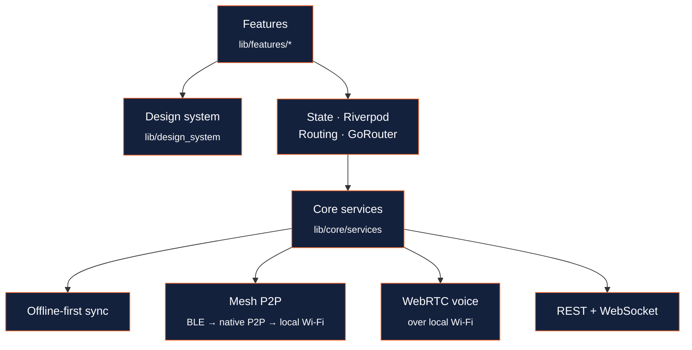

<div align="center">


# Kunfox

**A few minutes a day to pass your Baccalauréat — even without a connection.**

Offline-first revision for students in Cameroon: short lessons, quizzes that explain every mistake, and a daily streak.

[](https://github.com/rito27959-arch/educative_app/actions/workflows/ci.yml)


[**Website**](site) &nbsp;·&nbsp; [**Architecture**](#architecture) &nbsp;·&nbsp; [**Build**](#build)

</div>

<br>

## Why Kunfox

Many students revise on an entry-level phone, with a limited data plan and a network that drops. The best-known learning apps assume the opposite: a permanent connection and a recent phone. **Kunfox starts from the reality of its users.**

<table>
<tr>
<td width="25%" valign="top"><strong>Offline first</strong><br><sub>Lessons and quizzes live inside the app. The internet is only for syncing — never for learning.</sub></td>
<td width="25%" valign="top"><strong>Little, but daily</strong><br><sub>Lessons of a few minutes and a daily streak, rather than long sessions you abandon.</sub></td>
<td width="25%" valign="top"><strong>Mistakes explain</strong><br><sub>Every wrong answer is followed by an explanation, not a penalty.</sub></td>
<td width="25%" valign="top"><strong>Respect for students</strong><br><sub>No targeted advertising, no resale of data.</sub></td>
</tr>
</table>

## What's inside

| Area | Feature folders |
|:--|:--|
| **Learn** | `curriculum` (chapters, lessons, chapter and Bac exams), `courses`, `reader`, `mindmap` |
| **Practise** | `quiz`, `series`, `voice_coach` |
| **Stay motivated** | `gamification`, `dashboard`, `profile` |
| **Together** | `forum`, `calls` — revising in groups leans on [Droplet](https://dropletmesh.app), the messenger that works without internet |
| **Start** | `splash`, `onboarding`, `auth`, `settings` |

Current content covers the Cameroonian Baccalauréat — science, literary and technical streams. Other levels and countries will follow.

## Architecture

Clean Architecture, feature-first.



| Service | Purpose |
|:--|:--|
| `ApiService` | REST client with retry, cache and interceptors |
| `AuthService` | JWT authentication with refresh |
| `SyncService` | Offline-first sync engine |
| `WebSocketService` | Real-time communication |
| `WebRtcCallService` | Peer-to-peer voice calls |
| `AnalyticsService` | First-party event tracking — no third-party SDK |

## Build

```bash
./scripts/build.sh analyze              # static analysis (0 errors required)
./scripts/build.sh debug                # fast debug APK
./scripts/build.sh release_obfuscated   # obfuscated + shrunk release APK
```

Or directly:

```bash
flutter analyze lib/
flutter test
flutter build apk --release --target-platform android-arm64 --obfuscate --split-debug-info=build/debug-info
```

## Website

[`site/`](site) is the Kunfox website, built with Astro and destined for `kunfox.dropletmesh.app`: a light *Dawn* and dark *Fox Night* theme, an opening animation where the fox's cap drops onto its ear, and a phone whose screen follows the story as you scroll.

```sh
cd site && npm install && npm run dev
```

## Status

Kunfox is **in development** and not yet published on app stores. The Android package is still named `ouro_prep`, the project's earlier name.

## Author

Effi Djimeli Miguel Batime — founder · [LinkedIn](https://www.linkedin.com/in/miguel-effi-752011424)

<br>

<div align="center">
<sub>
Part of the <a href="https://dropletmesh.app">Droplet</a> family.
<br><br>
Designed and built in Yaoundé, Cameroon.
</sub>
</div>
